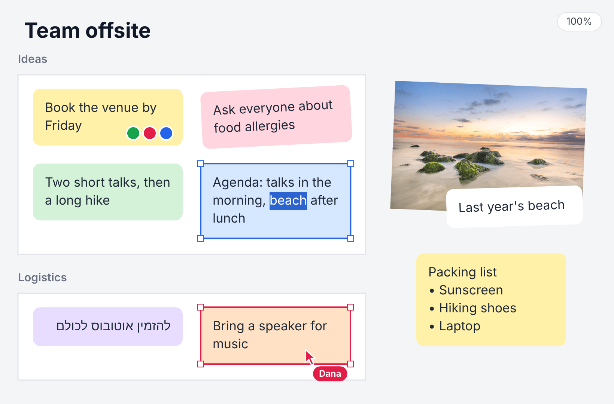
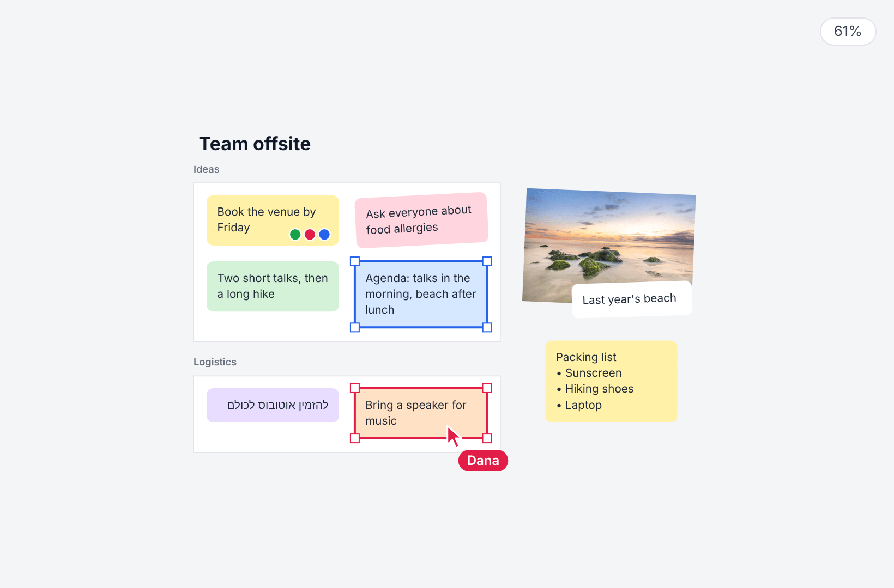

# microCanvas

A small TypeScript library for interactive canvas boards: shapes, text and images, with selecting, dragging, panning and zooming built in.

<!-- Screenshots of demos/board.html -->
<p>
  
  
</p>

## Usage

```ts
import { Canvas, Circle, McImage, McText, Rectangle } from "microcanvas";

// Fills its parent element, unless given { width, height } in CSS pixels.
const canvas = new Canvas(document.querySelector("canvas")!);

canvas.add(
    new Rectangle({ x: 40, y: 40, width: 120, height: 80, fill: "gold", draggable: true, resizable: true }),
    new Circle({ x: 260, y: 80, radius: 40, fill: null, stroke: "navy", strokeWidth: 4 }),
    new McText({ text: "Hello", x: 40, y: 170, fontSize: 24, draggable: true }),
    await McImage.load("photo.jpg", { x: 340, y: 40, width: 160, height: 100 }),
);
canvas.onSelect = (node) => console.log("selected", node);
canvas.onChange = (node) => console.log("moved to", node.x, node.y);
canvas.render();
```

- Users press to select, drag `draggable` nodes, drag the corners of a selected `resizable` node to resize it, drag empty space or scroll to pan, and pinch or Ctrl+wheel to zoom.
- After changing anything in code, call `render()`, or `requestRender()` to draw once on the next frame.
- Every node has `id`, `x`, `y`, `rotation`, `scaleX`, `scaleY`, `opacity`, `visible`, `layer`, `selectable`, `draggable` and `resizable`.
- Higher layers draw on top. Within a layer, nodes draw by `id`, so every board stacks them alike, and a new node can land under older ones: `canvas.bringToFront(node)` puts it on top.
- `Triangle`, `Diamond`, `Hexagon`, `Star`, `Arrow` and `Cursor` take a `width` and `height` like a `Rectangle`, and stretch to fill that box. Their strokes have round corners.
- `McText` lines break at `\n`, and given a `width` they also wrap to it at spaces and after hyphens, as a textarea does. A word longer than the width overflows it, and the box spans the width. Resizing it by a corner sets the width, and the font stays.
- `McText` styles: `padding` goes around the lines, outside the `width`, and `background` fills it, rounded by `cornerRadius`. `lineHeight` is times the font's height, and `stroke` and `strokeWidth` outline the letters.
- A `writable` text is edited in place by double-clicking it. Enter adds a line; Escape or a press elsewhere ends it, and `onChange` reports the edited node.
- `drawOverlay` draws on top of each render, such as more outlines with `drawOutline(node, color)`.
- `JSON.stringify(canvas)` saves the background and nodes, images by their URL. `canvas.fromJSON(JSON.parse(saved))` replaces them with the saved ones.
- An `McImage` draws a grey box until its file loads, or if it fails to, and stays selectable.
- To fill a parent, give the canvas a wrapper of its own, with no padding and nothing else inside.

## Install

Install it from a GitHub tag, which builds it on install:

```sh
npm install github:Amitmadh/microCanvas#v1.1.0
```

## Development

```sh
npx playwright install chromium firefox webkit   # once
npm test                        # unit tests in headless Chromium, Firefox and WebKit
npx vitest --browser=chromium   # unit tests in a visible Chromium, rerun on every change
npm run build
npx serve .                     # then open /demos/
```

## License

MIT
