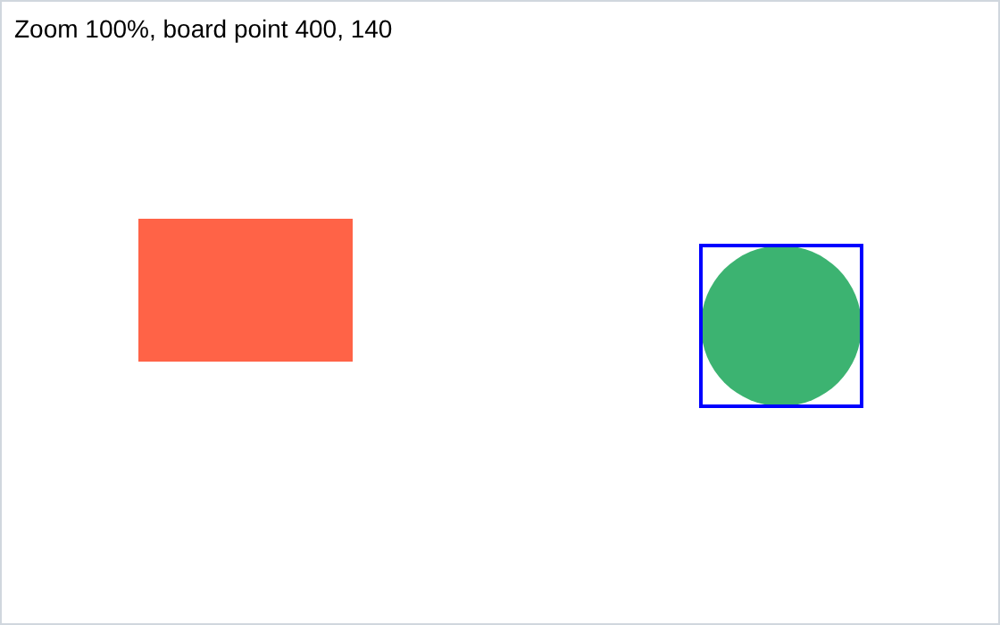
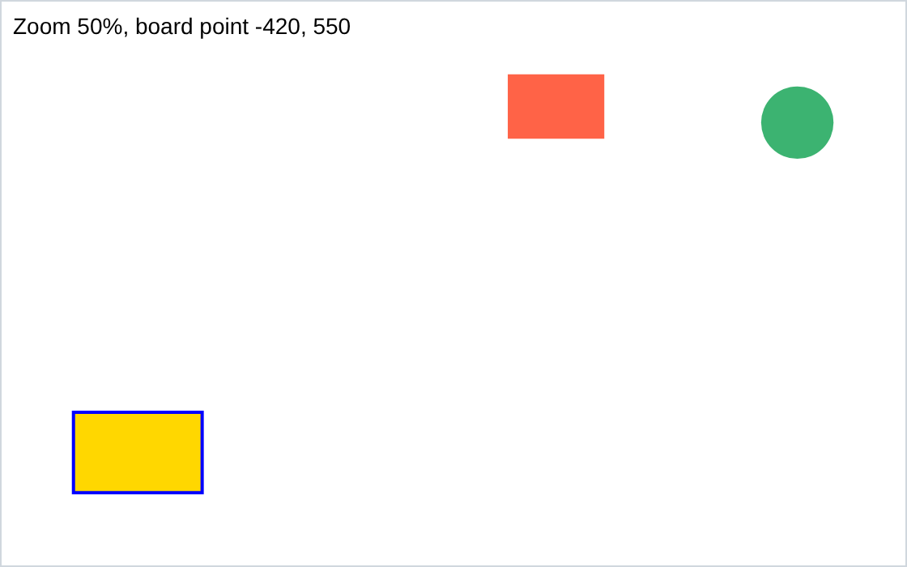

# microCanvas

A small TypeScript library for interactive canvas boards: shapes, text and images, with selecting, dragging, panning and zooming built in.

<!-- Screenshots of demos/viewport.html -->
<p>
  
  
</p>

## Usage

```ts
import { Canvas, Circle, McImage, McText, Rectangle } from "microcanvas";

// Fills its parent element, unless given { width, height } in CSS pixels.
const canvas = new Canvas(document.querySelector("canvas")!);

canvas.add(
    new Rectangle({ x: 40, y: 40, width: 120, height: 80, fill: "gold", draggable: true, resizable: true }),
    new Circle({ x: 260, y: 80, radius: 40, fill: null, stroke: "navy", strokeWidth: 4 }),
    new McText({ text: "Hello", x: 40, y: 170, fontSize: 24, draggable: true }),
    await McImage.load("photo.jpg", { x: 340, y: 40, width: 160, height: 100 }),
);
canvas.onSelect = (node) => console.log("selected", node);
canvas.onChange = (node) => console.log("moved to", node.x, node.y);
canvas.render();
```

- Users press to select, drag `draggable` nodes, drag the corners of a selected `resizable` node to resize it, drag empty space or scroll to pan, and pinch or Ctrl+wheel to zoom.
- After changing anything in code, call `render()`, or `requestRender()` to draw once on the next frame.
- Every node has `id`, `x`, `y`, `rotation`, `scaleX`, `scaleY`, `opacity`, `visible`, `layer`, `selectable`, `draggable` and `resizable`.
- Higher layers draw on top. Within a layer, nodes draw by `id`, so every board stacks them alike, and a new node can land under older ones: `canvas.bringToFront(node)` puts it on top.
- `McText` is one line, unless given a `width`: then it wraps to it, at spaces and at `\n`. Resizing it by a corner sets the width, and the font stays.
- `drawOverlay` draws on top of each render, such as more outlines with `drawOutline(node, color)`.
- `JSON.stringify(canvas)` saves the background and nodes, images by their URL. `canvas.fromJSON(JSON.parse(saved))` replaces them with the saved ones.
- To fill a parent, give the canvas a wrapper of its own, with no padding and nothing else inside.

## Install

Not on npm yet. Build it, then install it into your app from its folder:

```sh
npm install
npm run build
npm install path/to/microCanvas   # in your app
```

## Development

```sh
npx playwright install chromium firefox webkit   # once
npm test                        # unit tests in headless Chromium, Firefox and WebKit
npx vitest --browser=chromium   # unit tests in a visible Chromium, rerun on every change
npm run build
npx serve .                     # then open /demos/
```

## License

MIT
